<!-- Generated by build_readme.py: edit the scripts, not this file. -->
<p align="center">
  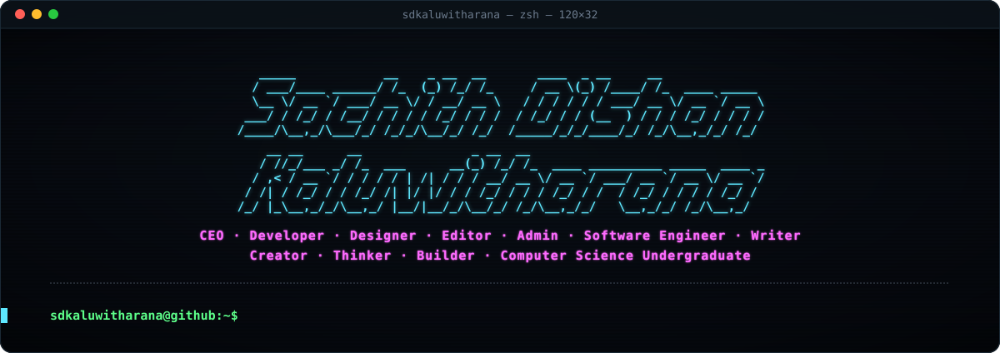
</p>

<p align="center">
  <a href="https://www.linkedin.com/in/sachith-dilshan-kaluwitharana/"></a>&nbsp;
  <a href="https://whatsapp.com/channel/0029VbB8cLlJ3jusy9XwZG2I"></a>&nbsp;
  <a href="https://sdkaluwitharana.lk"></a>&nbsp;
  <a href="mailto:info@sdkaluwitharana.lk"></a>&nbsp;
</p>

<p align="center">
  <a href="https://si.wikipedia.org/wiki/%E0%B6%B4%E0%B6%BB%E0%B7%92%E0%B7%81%E0%B7%93%E0%B6%BD%E0%B6%9A:Sachith_Dilshan_Kaluwitharana"></a>&nbsp;
  <a href="https://x.com/sdkaluwitharana"></a>&nbsp;
  <a href="https://sdkaluwitharana.blogspot.com/"></a>&nbsp;
</p>

### `$ whoami`

```python
class SachithDilshanKaluwitharana:

    def __init__(self):
        self.handle     = "sdkaluwitharana"
        self.location   = "Sri Lanka 🇱🇰"
        self.study      = "BSc (Hons) Computer Science @ NSBM Green University"
        self.since      = "2015"
        self.started    = ["Web Development", "Graphic Design", "Network Administration"]
        self.experience = "11 years, 9 months, 24 days"
        self.roles      = [
            "CEO", "Developer", "Designer", "Editor", "Admin",
            "Software Engineer", "Writer", "Creator", "Thinker", "Builder",
        ]

    def currently_building(self) -> list[str]:
        return [
            "LMS platforms for leading Sri Lankan A/L tuition masters",
            "Custom WordPress plugins",
            "Modern web apps",
            "Data Visualization",
            "AI/ML Model Training",
        ]

    def philosophy(self) -> str:
        return "Build. Deploy. Scale."


me = SachithDilshanKaluwitharana()
```

### `$ ls ~/projects`

<p align="center">
  <a href="https://sdkaluwitharana.lk">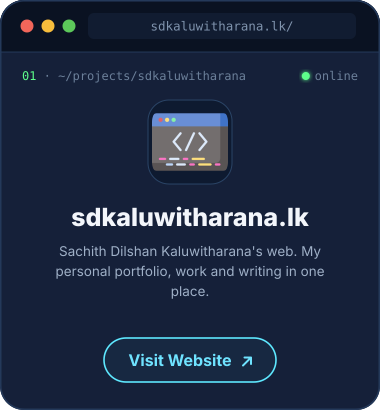</a>
  <a href="https://accountingking.lk"></a>
  <a href="https://lms.econtrust.lk"></a>
</p>
<p align="center">
  <a href="https://namaldilanka.lk"></a>
  <a href="https://deshanpathinayakebs.lk">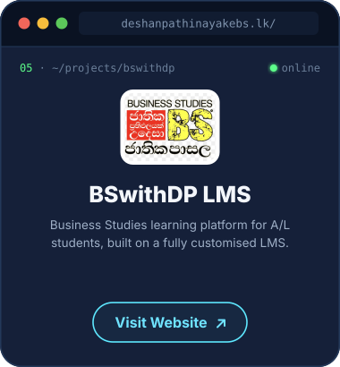</a>
</p>

### `$ cat ~/stack`

**`languages`**

<p align="left">
  <a href="https://developer.mozilla.org/en-US/docs/Web/HTML?ref=github.com/sdkaluwitharana" title="HTML"></a>
  <a href="https://developer.mozilla.org/en-US/docs/Web/CSS?ref=github.com/sdkaluwitharana" title="CSS">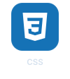</a>
  <a href="https://developer.mozilla.org/en-US/docs/Web/JavaScript?ref=github.com/sdkaluwitharana" title="JavaScript"></a>
  <a href="https://www.typescriptlang.org/?ref=github.com/sdkaluwitharana" title="TypeScript"></a>
  <a href="https://www.php.net/?ref=github.com/sdkaluwitharana" title="PHP"></a>
  <a href="https://www.python.org/?ref=github.com/sdkaluwitharana" title="Python">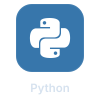</a>
  <a href="https://dev.java/?ref=github.com/sdkaluwitharana" title="Java">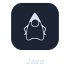</a>
  <a href="https://kotlinlang.org/?ref=github.com/sdkaluwitharana" title="Kotlin"></a>
  <a href="https://www.swift.org/?ref=github.com/sdkaluwitharana" title="Swift">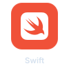</a>
  <a href="https://dart.dev/?ref=github.com/sdkaluwitharana" title="Dart"></a>
  <a href="https://isocpp.org/?ref=github.com/sdkaluwitharana" title="C++">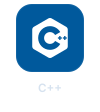</a>
  <a href="https://learn.microsoft.com/dotnet/csharp/?ref=github.com/sdkaluwitharana" title="C#">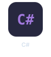</a>
  <a href="https://go.dev/?ref=github.com/sdkaluwitharana" title="Go"></a>
  <a href="https://www.rust-lang.org/?ref=github.com/sdkaluwitharana" title="Rust">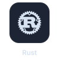</a>
  <a href="https://www.ruby-lang.org/?ref=github.com/sdkaluwitharana" title="Ruby"></a>
  <a href="https://www.r-project.org/?ref=github.com/sdkaluwitharana" title="R"></a>
  <a href="https://en.wikipedia.org/wiki/SQL?ref=github.com/sdkaluwitharana" title="SQL"></a>
  <a href="https://www.perl.org/?ref=github.com/sdkaluwitharana" title="Perl"></a>
  <a href="https://julialang.org/?ref=github.com/sdkaluwitharana" title="Julia"></a>
  <a href="https://www.mathworks.com/products/matlab.html?ref=github.com/sdkaluwitharana" title="MATLAB"></a>
  <a href="https://learn.microsoft.com/dotnet/visual-basic/?ref=github.com/sdkaluwitharana" title="Visual Basic"></a>
  <a href="https://www.freepascal.org/?ref=github.com/sdkaluwitharana" title="Pascal">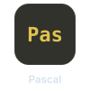</a>
  <a href="https://www.embarcadero.com/products/delphi?ref=github.com/sdkaluwitharana" title="Delphi / Object Pascal">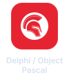</a>
  <a href="https://fortran-lang.org/?ref=github.com/sdkaluwitharana" title="Fortran"></a>
  <a href="https://en.wikipedia.org/wiki/COBOL?ref=github.com/sdkaluwitharana" title="COBOL">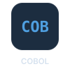</a>
  <a href="https://en.wikipedia.org/wiki/Assembly_language?ref=github.com/sdkaluwitharana" title="Assembly">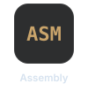</a>
  <a href="https://scratch.mit.edu/?ref=github.com/sdkaluwitharana" title="Scratch"></a>
</p>

**`frontend`**

<p align="left">
  <a href="https://react.dev/?ref=github.com/sdkaluwitharana" title="React"></a>
  <a href="https://vuejs.org/?ref=github.com/sdkaluwitharana" title="Vue.js"></a>
  <a href="https://angular.dev/?ref=github.com/sdkaluwitharana" title="Angular">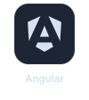</a>
  <a href="https://svelte.dev/?ref=github.com/sdkaluwitharana" title="Svelte"></a>
  <a href="https://astro.build/?ref=github.com/sdkaluwitharana" title="Astro"></a>
  <a href="https://getbootstrap.com/?ref=github.com/sdkaluwitharana" title="Bootstrap"></a>
  <a href="https://tailwindcss.com/?ref=github.com/sdkaluwitharana" title="Tailwind CSS"></a>
  <a href="https://jquery.com/?ref=github.com/sdkaluwitharana" title="jQuery"></a>
</p>

**`backend`**

<p align="left">
  <a href="https://nodejs.org/?ref=github.com/sdkaluwitharana" title="Node.js"></a>
  <a href="https://laravel.com/?ref=github.com/sdkaluwitharana" title="Laravel">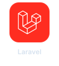</a>
  <a href="https://www.djangoproject.com/?ref=github.com/sdkaluwitharana" title="Django"></a>
  <a href="https://fastapi.tiangolo.com/?ref=github.com/sdkaluwitharana" title="FastAPI"></a>
  <a href="https://spring.io/projects/spring-boot?ref=github.com/sdkaluwitharana" title="Spring Boot"></a>
  <a href="https://dotnet.microsoft.com/apps/aspnet?ref=github.com/sdkaluwitharana" title="ASP.NET"></a>
  <a href="https://wordpress.org/?ref=github.com/sdkaluwitharana" title="WordPress"></a>
  <a href="https://www.mongodb.com/resources/languages/mern-stack?ref=github.com/sdkaluwitharana" title="MERN Stack">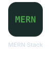</a>
</p>

**`ai / ml / dl`**

<p align="left">
  <a href="https://www.tensorflow.org/?ref=github.com/sdkaluwitharana" title="TensorFlow"></a>
  <a href="https://keras.io/?ref=github.com/sdkaluwitharana" title="Keras"></a>
  <a href="https://pytorch.org/?ref=github.com/sdkaluwitharana" title="PyTorch"></a>
  <a href="https://scikit-learn.org/?ref=github.com/sdkaluwitharana" title="scikit-learn"></a>
  <a href="https://developer.nvidia.com/cuda-toolkit?ref=github.com/sdkaluwitharana" title="CUDA"></a>
  <a href="https://opencv.org/?ref=github.com/sdkaluwitharana" title="OpenCV"></a>
  <a href="https://ollama.com/?ref=github.com/sdkaluwitharana" title="Ollama">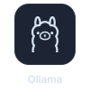</a>
  <a href="https://pjreddie.com/darknet/?ref=github.com/sdkaluwitharana" title="Darknet"></a>
</p>

**`data`**

<p align="left">
  <a href="https://pandas.pydata.org/?ref=github.com/sdkaluwitharana" title="pandas"></a>
  <a href="https://numpy.org/?ref=github.com/sdkaluwitharana" title="NumPy">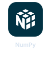</a>
  <a href="https://pola.rs/?ref=github.com/sdkaluwitharana" title="Polars">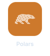</a>
  <a href="https://jupyter.org/?ref=github.com/sdkaluwitharana" title="Jupyter"></a>
  <a href="https://ggplot2.tidyverse.org/?ref=github.com/sdkaluwitharana" title="ggplot2"></a>
</p>

**`databases`**

<p align="left">
  <a href="https://www.mysql.com/?ref=github.com/sdkaluwitharana" title="MySQL"></a>
  <a href="https://mariadb.org/?ref=github.com/sdkaluwitharana" title="MariaDB"></a>
  <a href="https://www.postgresql.org/?ref=github.com/sdkaluwitharana" title="PostgreSQL"></a>
  <a href="https://www.sqlite.org/?ref=github.com/sdkaluwitharana" title="SQLite"></a>
  <a href="https://www.oracle.com/database/?ref=github.com/sdkaluwitharana" title="Oracle Database"></a>
  <a href="https://www.mongodb.com/?ref=github.com/sdkaluwitharana" title="MongoDB"></a>
  <a href="https://redis.io/?ref=github.com/sdkaluwitharana" title="Redis"></a>
  <a href="https://neo4j.com/?ref=github.com/sdkaluwitharana" title="Neo4j"></a>
  <a href="https://www.trychroma.com/?ref=github.com/sdkaluwitharana" title="ChromaDB">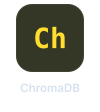</a>
  <a href="https://www.pinecone.io/?ref=github.com/sdkaluwitharana" title="Pinecone">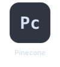</a>
  <a href="https://cloud.google.com/bigquery?ref=github.com/sdkaluwitharana" title="BigQuery"></a>
</p>

**`cloud & devops`**

<p align="left">
  <a href="https://aws.amazon.com/?ref=github.com/sdkaluwitharana" title="AWS"></a>
  <a href="https://www.digitalocean.com/?ref=github.com/sdkaluwitharana" title="DigitalOcean"></a>
  <a href="https://vercel.com/?ref=github.com/sdkaluwitharana" title="Vercel">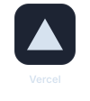</a>
  <a href="https://www.docker.com/?ref=github.com/sdkaluwitharana" title="Docker"></a>
  <a href="https://www.mamp.info/?ref=github.com/sdkaluwitharana" title="MAMP"></a>
</p>

**`mobile & app stores`**

<p align="left">
  <a href="https://flutter.dev/?ref=github.com/sdkaluwitharana" title="Flutter"></a>
  <a href="https://www.android.com/?ref=github.com/sdkaluwitharana" title="Android"></a>
  <a href="https://www.apple.com/ios/?ref=github.com/sdkaluwitharana" title="iOS"></a>
  <a href="https://www.apple.com/ipados/?ref=github.com/sdkaluwitharana" title="iPadOS"></a>
  <a href="https://www.apple.com/watchos/?ref=github.com/sdkaluwitharana" title="watchOS"></a>
  <a href="https://www.apple.com/app-store/?ref=github.com/sdkaluwitharana" title="App Store"></a>
  <a href="https://play.google.com/?ref=github.com/sdkaluwitharana" title="Play Store"></a>
  <a href="https://apps.microsoft.com/?ref=github.com/sdkaluwitharana" title="Microsoft Store"></a>
  <a href="https://appgallery.huawei.com/?ref=github.com/sdkaluwitharana" title="Huawei AppGallery"></a>
</p>

**`operating systems`**

<p align="left">
  <a href="https://www.apple.com/macos/?ref=github.com/sdkaluwitharana" title="macOS">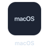</a>
  <a href="https://www.microsoft.com/windows?ref=github.com/sdkaluwitharana" title="Windows"></a>
  <a href="https://www.microsoft.com/windows-server?ref=github.com/sdkaluwitharana" title="Windows Server"></a>
  <a href="https://www.kernel.org/?ref=github.com/sdkaluwitharana" title="Linux"></a>
  <a href="https://ubuntu.com/?ref=github.com/sdkaluwitharana" title="Ubuntu"></a>
  <a href="https://www.debian.org/?ref=github.com/sdkaluwitharana" title="Debian">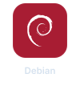</a>
  <a href="https://fedoraproject.org/?ref=github.com/sdkaluwitharana" title="Fedora"></a>
  <a href="https://archlinux.org/?ref=github.com/sdkaluwitharana" title="Arch Linux"></a>
  <a href="https://www.kali.org/?ref=github.com/sdkaluwitharana" title="Kali Linux"></a>
  <a href="https://www.opensuse.org/?ref=github.com/sdkaluwitharana" title="openSUSE"></a>
  <a href="https://www.gentoo.org/?ref=github.com/sdkaluwitharana" title="Gentoo"></a>
  <a href="https://www.qubes-os.org/?ref=github.com/sdkaluwitharana" title="Qubes OS"></a>
  <a href="https://mobian-project.org/?ref=github.com/sdkaluwitharana" title="Mobian"></a>
  <a href="https://www.hanthana.org/?ref=github.com/sdkaluwitharana" title="Hanthana Linux"></a>
  <a href="https://chromeos.google/?ref=github.com/sdkaluwitharana" title="ChromeOS">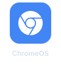</a>
</p>

**`browsers`**

<p align="left">
  <a href="https://www.google.com/chrome/?ref=github.com/sdkaluwitharana" title="Chrome"></a>
  <a href="https://www.chromium.org/?ref=github.com/sdkaluwitharana" title="Chromium">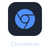</a>
  <a href="https://www.mozilla.org/firefox/?ref=github.com/sdkaluwitharana" title="Firefox"></a>
  <a href="https://www.apple.com/safari/?ref=github.com/sdkaluwitharana" title="Safari"></a>
  <a href="https://www.torproject.org/?ref=github.com/sdkaluwitharana" title="Tor"></a>
</p>

**`security & computer science`**

<p align="left">
  <a href="https://en.wikipedia.org/wiki/Cryptography?ref=github.com/sdkaluwitharana" title="Cryptography"></a>
  <a href="https://en.wikipedia.org/wiki/Cryptocurrency?ref=github.com/sdkaluwitharana" title="Cryptocurrency"></a>
  <a href="https://the-algorithms.com/?ref=github.com/sdkaluwitharana" title="Algorithms &amp; Data Structures">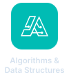</a>
  <a href="https://www.widevine.com/?ref=github.com/sdkaluwitharana" title="Widevine"></a>
</p>

**`terminal & remote`**

<p align="left">
  <a href="https://support.apple.com/guide/terminal/welcome/mac?ref=github.com/sdkaluwitharana" title="Terminal">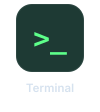</a>
  <a href="https://learn.microsoft.com/powershell/?ref=github.com/sdkaluwitharana" title="PowerShell">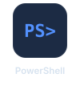</a>
  <a href="https://learn.microsoft.com/windows-server/administration/windows-commands/cmd?ref=github.com/sdkaluwitharana" title="CMD">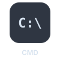</a>
  <a href="https://ish.app/?ref=github.com/sdkaluwitharana" title="iSH"></a>
  <a href="https://termius.com/?ref=github.com/sdkaluwitharana" title="Termius"></a>
  <a href="https://www.chiark.greenend.org.uk/~sgtatham/putty/?ref=github.com/sdkaluwitharana" title="PuTTY"></a>
  <a href="https://www.openssh.com/?ref=github.com/sdkaluwitharana" title="SSH"></a>
  <a href="https://en.wikipedia.org/wiki/SSH_File_Transfer_Protocol?ref=github.com/sdkaluwitharana" title="SFTP">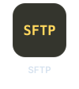</a>
  <a href="https://datatracker.ietf.org/doc/html/rfc854?ref=github.com/sdkaluwitharana" title="Telnet">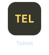</a>
</p>

**`communities & learning`**

<p align="left">
  <a href="https://www.discourse.org/?ref=github.com/sdkaluwitharana" title="Discourse"></a>
  <a href="https://xenforo.com/?ref=github.com/sdkaluwitharana" title="XenForo"></a>
  <a href="https://flarum.org/?ref=github.com/sdkaluwitharana" title="Flarum">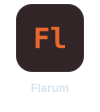</a>
  <a href="https://mybb.com/?ref=github.com/sdkaluwitharana" title="MyBB"></a>
  <a href="https://nodebb.org/?ref=github.com/sdkaluwitharana" title="NodeBB">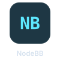</a>
  <a href="https://moodle.org/?ref=github.com/sdkaluwitharana" title="Moodle"></a>
</p>

**`design & 3d`**

<p align="left">
  <a href="https://www.adobe.com/products/photoshop.html?ref=github.com/sdkaluwitharana" title="Photoshop"></a>
  <a href="https://www.adobe.com/products/illustrator.html?ref=github.com/sdkaluwitharana" title="Illustrator"></a>
  <a href="https://www.figma.com/?ref=github.com/sdkaluwitharana" title="Figma"></a>
  <a href="https://www.canva.com/?ref=github.com/sdkaluwitharana" title="Canva"></a>
  <a href="https://www.blender.org/?ref=github.com/sdkaluwitharana" title="Blender"></a>
</p>

**`video & photo editing`**

<p align="left">
  <a href="https://www.adobe.com/products/premiere.html?ref=github.com/sdkaluwitharana" title="Premiere Pro"></a>
  <a href="https://www.adobe.com/products/aftereffects.html?ref=github.com/sdkaluwitharana" title="After Effects">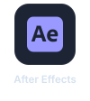</a>
  <a href="https://www.adobe.com/products/photoshop-lightroom.html?ref=github.com/sdkaluwitharana" title="Lightroom"></a>
  <a href="https://www.blackmagicdesign.com/products/davinciresolve?ref=github.com/sdkaluwitharana" title="DaVinci Resolve"></a>
</p>

**`ides & tools`**

<p align="left">
  <a href="https://code.visualstudio.com/?ref=github.com/sdkaluwitharana" title="VS Code">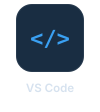</a>
  <a href="https://www.jetbrains.com/rider/?ref=github.com/sdkaluwitharana" title="JetBrains Rider"></a>
  <a href="https://www.jetbrains.com/pycharm/?ref=github.com/sdkaluwitharana" title="PyCharm"></a>
  <a href="https://www.jetbrains.com/webstorm/?ref=github.com/sdkaluwitharana" title="WebStorm"></a>
  <a href="https://www.jetbrains.com/idea/?ref=github.com/sdkaluwitharana" title="IntelliJ IDEA"></a>
  <a href="https://developer.android.com/studio?ref=github.com/sdkaluwitharana" title="Android Studio"></a>
  <a href="https://developer.apple.com/xcode/?ref=github.com/sdkaluwitharana" title="Xcode">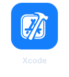</a>
  <a href="https://netbeans.apache.org/?ref=github.com/sdkaluwitharana" title="NetBeans">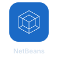</a>
  <a href="https://git-scm.com/?ref=github.com/sdkaluwitharana" title="Git"></a>
  <a href="https://github.com/?ref=github.com/sdkaluwitharana" title="GitHub"></a>
  <a href="https://www.postman.com/?ref=github.com/sdkaluwitharana" title="Postman">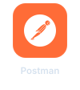</a>
</p>

### `$ git log --stats`

<p align="center">
  
  
</p>

<p align="center">
  
</p>

### `$ ./snake.sh`

<p align="center">
  <picture>
    <source media="(prefers-color-scheme: dark)" srcset="https://raw.githubusercontent.com/sdkaluwitharana/sdkaluwitharana/output/github-snake-dark.svg" />
    
  </picture>
</p>

<p align="center">
  
</p>
